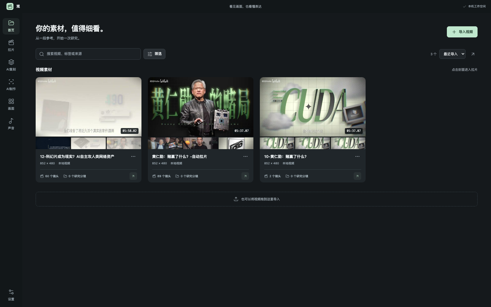
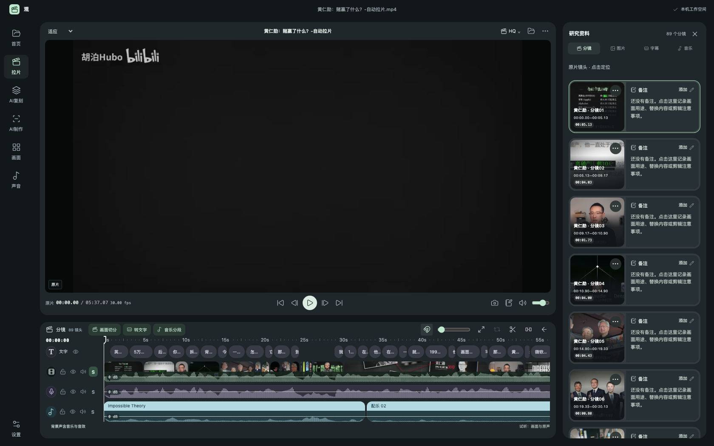
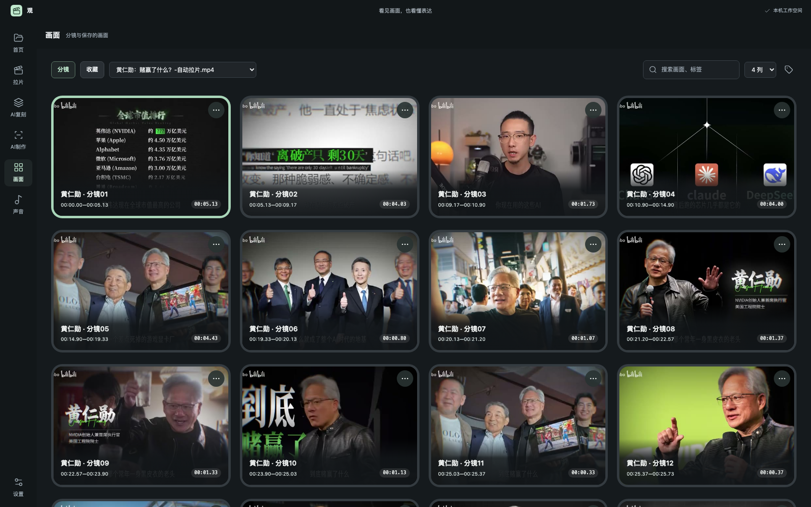
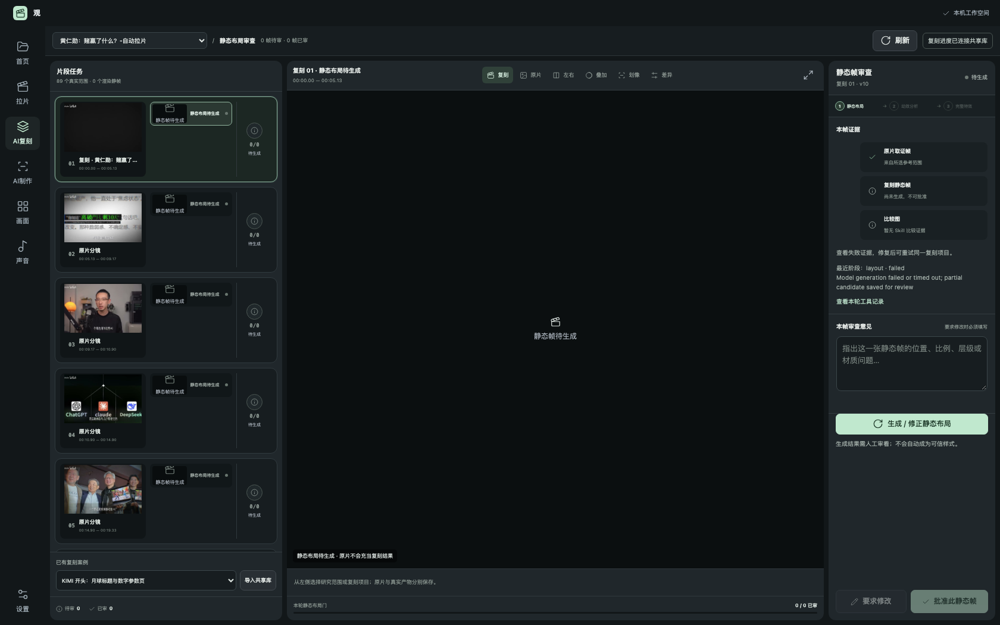
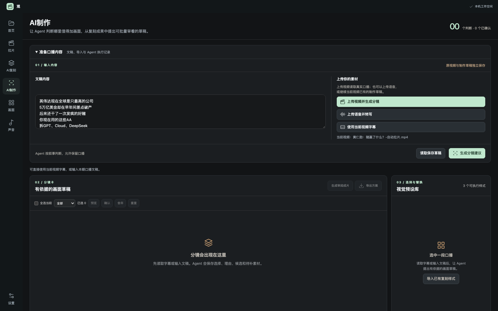

# 观 · Guan

> 观乎人文，以化成天下。——《易经·观卦》
>
> "Behold the patterns of human culture, and through them, transform the world." — I Ching, Hexagram 20 (Guan / Contemplation)

**看见画面，也看懂表达。**
**Watch closely. Understand the craft.**

---

## 这是什么

「观」是一个**运行在本机**的 AI 视频工作台，做三件事：

1. **拉片** —— 把一段参考视频拆开看：自动分镜、逐帧核对、字幕转写、音乐分段、分轨回听、画面笔记，每一条研究都能精确回到原片时间点。
2. **AI 复刻** —— 把参考片里的画面表达（布局、动效、字体、层级）复刻成可复用的样式，左任务、中静帧、右审批，逐帧人工把关，成果进入共享样式库。
3. **AI 制作** —— 给自己的口播视频自动配画面：Agent 读文稿、查样式库与素材，提出逐句的分镜草稿；你审看、替换、确认，确认的画面才进入成片。

所有媒体与数据留在本机。基础拉片完全离线；AI 制作使用本机已登录的 Codex 账号。

## What is this

**Guan** is a **local-first** AI video workbench that does three things:

1. **Film study (拉片)** — take a reference video apart: automatic shot detection, frame-by-frame review, transcription, music segmentation, split-track listening, and timestamped notes that always lead back to the exact source moment.
2. **AI replication** — recreate the visual language of a reference (layout, motion, typography, layering) into reusable styles, with a tasks / still-frames / approval three-column review flow. Approved results join a shared style library.
3. **AI production** — turn your own talking-head footage into a storyboard: an agent reads the script, searches the style library and assets, then proposes per-sentence visuals. You review, swap, and approve — only approved frames enter the final render.

All media and data stay on your machine. Basic film study works fully offline; AI production uses a locally signed-in Codex account.

## 截图 · Screenshots

| 视频库 Library | 拉片时间线 Analysis |
| --- | --- |
|  |  |

| 分镜画面 Frames | AI 复刻审批 Replica review |
| --- | --- |
|  |  |

| AI 制作 AI production |
| --- |
|  |

## 运行环境 · Requirements

在本机（开发机）已验证的配置 / Verified on the development machine:

| 项目 Item | 配置 Spec |
| --- | --- |
| 机型 Machine | MacBook Air, Apple M4, 16 GB RAM |
| 系统 OS | macOS 26.5 |
| Python | 3.12.14 |
| Node.js | v24.15.0 |
| FFmpeg | 8.1 |
| 磁盘 Disk | 首次运行需下载本地模型，建议预留 5 GB / first run downloads local models, reserve ~5 GB |

其他 Mac（Apple Silicon 优先）理论上可运行，但未逐一验证；Windows / Linux 未适配。
Other Macs (Apple Silicon preferred) should work but are not individually verified; Windows / Linux are not supported.

## 安装与启动 · Install & Run

```bash
git clone https://github.com/liaojianquan9-source/guan-workbench.git
cd guan-workbench/prototypes/broll-workbench
./start.command        # 或双击访达中的 start.command / or double-click in Finder
```

启动脚本会自动：检查并修复 Python 3.12 虚拟环境、按锁定清单补齐依赖、下载本地模型（Whisper large-v3-turbo、TransNetV2），然后一起拉起三个本机服务：

The launcher checks and repairs the Python 3.12 virtualenvs, installs pinned dependencies, downloads local models (Whisper large-v3-turbo, TransNetV2), then starts three local services:

| 端口 Port | 服务 Service |
| --- | --- |
| 4182 | 「观」工作台主入口 Main workbench UI |
| 4183 | 内部制作引擎（不必直接打开）Internal production engine |
| 4184 | 共享样式资产库（不必直接打开）Shared asset library |

启动后打开 After launch, open <http://127.0.0.1:4182/?view=ai-making>。

**AI 制作**额外需要本机已登录的 Codex 账号（消耗该账号额度）；没有它，拉片与复刻研究不受影响。
**AI production** additionally requires a signed-in Codex account on the machine (it consumes that account's quota); film study and replication research work without it.

## 实际使用的处理方式 · How things actually work

| 能力 Capability | 实现 Implementation | 联网 Network |
| --- | --- | --- |
| 播放、逐帧、缩略图、波形 Playback, frames, thumbnails, waveforms | 浏览器 + 本机 FFmpeg / FFprobe | 否 No |
| 自动分镜 Shot detection | TransNetV2（本地模型 local model） | 否 No |
| 语音转字幕 Transcription | whisper.cpp + large-v3-turbo（优先 Metal） | 否 No |
| 歌曲识别 Music recognition | 本地指纹 → Shazam → iTunes | 是 Yes |
| AI 制作的判断与草稿 Agent reasoning & drafts | 本机已登录的 Codex 账号 | 是（发送文稿与抽帧） Yes (script & sampled frames) |
| 样式替换与成片合成 Style swap & final render | 本机 Remotion + FFmpeg | 否 No |

## 项目结构 · Repository layout

```
prototypes/broll-workbench/   「观」工作台主体（服务器、前端、测试）Main workbench
apps/broll-agent/             内部制作引擎与共享资产服务 Production engine & asset service
skills/                       复刻技能（布局结构、视频样式）Replication skills
docs/                         产品文档、阶段记录、截图 Product docs & screenshots
tests/                        文稿与封面回归测试 Manuscript & cover regression tests
```

## 验证 · Verification

```bash
cd prototypes/broll-workbench && ./verify.command   # 语法 + 后端 + 前端 150 项回归
cd apps/broll-agent && ./verify.command             # 引擎、渲染与界面回归
```

## 路线图 · Roadmap

以下能力尚未验收，欢迎一起推进 / The following are not yet validated — contributions welcome:

- 任意新参考从布局到动效、保真的全自动复刻 Fully automatic replication of any new reference, layout → motion → fidelity
- 修改意见自动驱动重新生成 Review comments automatically driving regeneration
- 任意候选一键发布 One-click publishing of any approved candidate

## 隐私 · Privacy

本机优先：视频、字幕、笔记与样式库都保存在你自己的电脑上。仅歌曲识别与 AI 制作需要联网，上面表格逐项写明。仓库不包含任何个人素材；截图均来自公开演示内容。

Local-first: videos, transcripts, notes and the style library stay on your machine. Only music recognition and AI production use the network, as itemized above. This repository ships no personal footage; screenshots show public demo content only.

## License

[MIT](LICENSE) © 2026 观 (Guan) contributors
