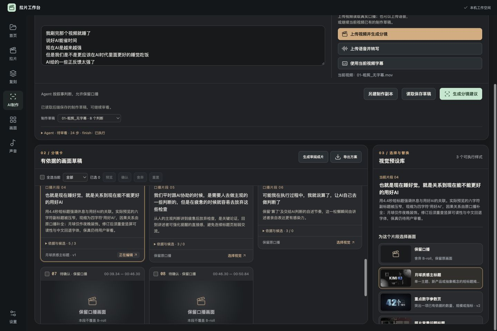
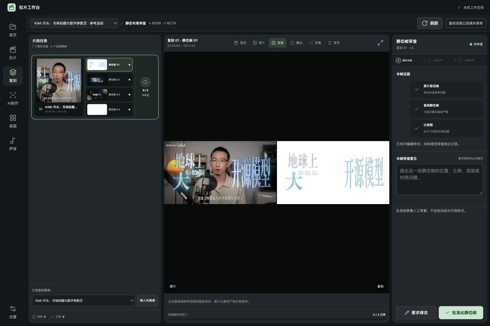
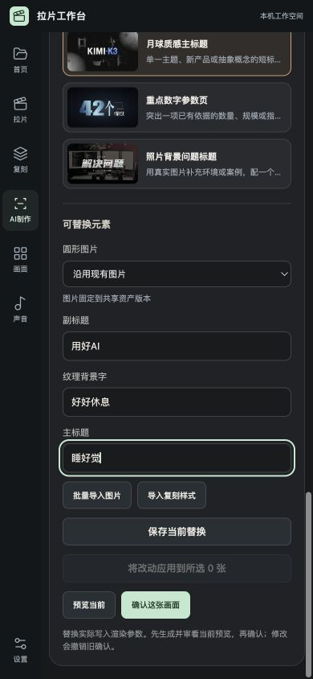

# 当前可审看证据（阶段尚未完成）

打开 [现有AI工作台](http://127.0.0.1:4182/?project=4d54541e7863421298b8731216accaea&view=ai-making)，检查当前53秒口播的8张草稿；卡片应显示判断依据、素材缺口和真实预览。所有卡仍待用户审看。

本轮待解决：横版样式用于竖屏时留黑过大，已请用户选择处理方式；任意新参考的完整复刻尚未验证。不能据“服务能打开”或“测试通过”宣布产品完成。

操作：在AI制作页打开第4张卡，播放真实替换预览；制作草稿菜单切换“验收副本 · 跨项目复用”可查看两张卡及整片结果。原项目仍为待审草稿。复刻页选择“KIMI 开头：月球标题与数字参数页 · 参考选段”，点“左右”看真实原片与复刻帧；尚未生成的任务不能批准。

[真实53秒合成视频](http://127.0.0.1:4182/api/production/files/55f721ea649548f09828381ed1666a6f/final-63583a8d577a4c2d9ebed2be4b8f2a5a.mp4)。这是技术验收副本，视觉效果未获用户批准。

| # | 检查项 | 是 / 否 |
| --- | --- | --- |
| 1 | 本轮范围内功能已实现 | 否，原入口功能已修复；跨画幅效果取舍与任意新参考闭环仍未通过验收 |
| 2 | 更新后的全部自动测试通过 | 是，工作台102/102后端、103/103前端；制作引擎72/72后端、20/20前端，共297/297 |
| 3 | 真实模型冒烟运行 | 是，真实口播完成取证、比较、渲染、修订和复检；效果仍待用户审看 |
| 4 | 语法/前端行为/渲染构建检查通过 | 是，两个验证入口全部通过；实际样式已完成Remotion渲染 |
| 5 | 密钥未进入本轮代码及证据 | 是，本轮代码与证据检查未发现密钥；认证沿用本机Codex登录 |
| 6 | 实际服务重启后数据可恢复 | 是，从原启动器重启三个服务，两个项目的完整内容哈希及版本保持一致 |
| 7 | 桌面与移动宽度已检查 | 是，CUA实测AI制作1440×960与390×844，无水平溢出；可滚到替换控件。复刻桌面对比已检查，移动端完整操作仍未验收 |
| 8 | 启动和验证说明已更新 | 是，原start.command一起启动三个服务；两个README已更新 |
| 9 | 项目状态已更新 | 是，包含已定/待定判断和真实限制 |
| 10 | 页面截图、入口、是否表已交付 | 是，本目录有实际截图、可打开入口与本表 |

播放复核：首次内置浏览器点击播放曾崩溃一次，原因未确定；新标签恢复同一项目后，实际4.4秒预览完整播放，1080×1920、readyState4、ended=true、无媒体错误。保留该偶发问题记录，不归因于未经验证的原因。
