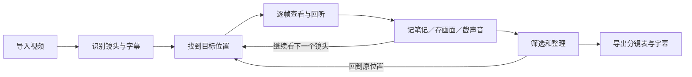

# 拉片工作台：用户旅程与对抗性审查

> **⚠️ 历史记录：I/O 已于 2026-09-19 下线、仅作当时留档。**

2026-09-18。只针对拉片；包含真实浏览器操作、源码检查、独立测试资料库和自动回归。

## 从用户目的出发

用户要找到值得研究的镜头，看清画面与声音，把观察和片段保存下来，以后准确找回。因此每一步必须做到：知道当前位置、操作有明确结果、定位可以细调、结果能回到来源、误操作能恢复。

| 旅程阶段 | 用户需要的结果 | 本轮处理 |
| --- | --- | --- |
| 导入与识别 | 知道文件进来了，下一步点哪里 | 把只有图标的入口改为明确的“识别镜头／分镜”和“字幕” |
| 找位置 | 点击前后都知道在哪一秒 | 时间刻度、位置提示、边界吸附；可以关闭或按 Alt 临时绕过 |
| 逐帧查看 | 暂停稳定，缩放不迷路 | 修正跳转归零与迟到自动播放；缩放保留播放指针的屏幕位置 |
| 记录和收集 | 保存一次，不重不丢 | 防重复提交，显示保存反馈；原有草稿恢复保留 |
| 整理与回找 | 收藏能点开，能回到原片 | 整张收藏卡片可点击与键盘操作；准确回到对应帧 |
| 中断与误操作 | 回来能接着做 | 恢复位置、选区、缩放、展开状态；提供即时撤销 |
| 导出 | 知道内容是否齐全 | 已有导出保留；完整性提示列入后续待办 |

## 会阻断操作的问题：已修复

| Before（原来） | After（现在） | Why（为什么） |
| --- | --- | --- |
| 点击收集区图片没有反应 | 图片与标题一起成为可打开详情的按钮 | 用户不应猜哪块区域才可点击 |
| 从画面详情回到 6.83 秒，却落到 0 秒 | 返回原视频的对应帧 | 收藏与来源必须指向同一时刻 |
| 切换视频后立刻点镜头，旧自动播放请求可能稍后启动 | 定位并暂停会取消旧的自动播放意图 | 最后一次用户操作优先 |
| 双击截图会保存两份相同文件 | 同一次保存只执行一次，进行中有反馈 | 避免重复素材与不确定感 |
| 保存的迟到回应可能关闭后来打开的窗口 | 只关闭本次保存对应的窗口，保留更新的草稿 | 后台结果不能覆盖后续操作 |

## 高频操作与反馈：已优化

| Before（原来） | After（现在） | Why（为什么） |
| --- | --- | --- |
| 图片轨与波形缺少刻度、指向提示 | 增加时间刻度、指向线和定位文字 | 点击前就能判断位置 |
| 靠近切点仍要反复调整 | 吸附镜头边界、笔记点；声音轨还吸附字幕边界 | 减少微调，仍允许自由定位 |
| 放大时间轴后当前位置在屏幕上跳动 | 保留当前可见播放位置；不在视野中则保留视野中心 | 放大后不用重新找位置 |
| 当前镜头或字幕可能留在视野外 | 定位和播放时跟随；手动滚动后暂时停止跟随 | 保持联动，也允许看其他段落 |
| 声音入出点能拖过彼此 | 保持顺序和有效长度，支持方向键微调 | 避免倒置或不能保存的选区 |
| 切页、刷新后丢失观看位置与选区 | 按视频记住位置、选区、展开方式和缩放 | 可以中断后继续 |
| 移除后只能看到记录消失 | 笔记、素材、视频和本地音乐的移除提示提供即时撤销 | 误操作有直接返回路径 |
| 改了快捷键，提示仍显示旧键 | 提示与设置同步 | 帮助信息与实际操作一致 |
| 窄窗口按钮拥挤 | 侧栏收起；主要播放按钮在手机宽度下为 44×44，分行排列 | 高频操作保持可点击、可辨认 |
| 静止时持续重绘，分镜网格里仍显示无效果的时间轴缩放 | 暂停时停止连续重绘；只在适用的视图显示缩放与吸附 | 降低无效刷新，避免无反馈控件 |
| 时间接近整分钟时可能显示 00:60.00 | 正确进位为 01:00.00 | 时间读数应当可信 |

吸附同时受屏幕距离和时间距离限制：不超过 8 像素，且不超过 0.3 秒，取最近目标。按住 Alt 临时取消，方向键始终保持逐帧。手机上的所有小手柄尚未全部达到 44 像素；主要使用场景仍是电脑。

## 对抗性测试：实际结果

| 故意制造的情况 | 实际结果 |
| --- | --- |
| 同一点分别开、关吸附 | 开启落在 8.30 秒切点，关闭落在 8.40 秒 |
| 有笔记锚点时普通点击与 Alt 点击 | 普通点击吸到 6.10 秒；Alt 停在 6.00 秒 |
| 快速双击截图 | 修复前新增 2 张；修复后只新增 1 张 |
| 快速双击保存笔记 | 只新增一条，原有笔记保留 |
| 快速切换播放／暂停 10 次 | 最终正确暂停，无错误提示与控制台错误 |
| 切换视频后立刻点镜头 | 停在指定镜头并保持暂停 |
| 从第 90 镜详情回到拉片 | 定位约 321.23 秒，分镜列表滚到当前镜头可见处 |
| 设置与拉片来回切换 | 保持 6.83 秒，不回片头 |
| 刷新页面 | 观看位置恢复；9.20—10.933333 秒声音选区恢复 |
| 入点拖到出点后，再把出点移到最前 | 仍保持入点小于出点，不越过视频首尾 |
| 时间轴从 1 倍放大到 10 倍 | 播放指针位置从 432.59px 到 432.49px，相差约 0.1px |
| 移除截图再撤销 | 列表从 1 条变 0 条，再恢复为 1 条 |
| 删除笔记后撤销 | 原文和 6.10 秒时间点恢复 |
| 取消笔记后重新打开 | 未保存草稿恢复 |
| 将截图快捷键改成 Q | 播放页同步显示 Q，测试后恢复默认 |
| 375px 与 320px 窗口 | 无页面横向溢出，主要播放按钮未超出窗口 |

**自动检查：21 项后端回归 + 9 项交互规则，合计 30 项通过。** 覆盖真实媒体读写、非法输入、版本冲突、任务失败恢复，以及吸附、不同帧率、越界、缩放锚点、重复提交、失败重试和时间进位。

浏览器操作在 `/tmp/lapian-ui-data` 的测试资料和项目副本中完成。正式媒体未被改写。与上一轮文件基线相比，99 个文件相同，1 份项目记录新增了识曲结果；该记录与本轮中途建立的正式项目副本逐字节一致，新结果已保留。不能据此声称整个审查期间所有正式文件完全未变。

本轮没有重新验证模型识别准确率，没有把协议测试替身当成真实模型效果，也没有声称所有网络、文件大小和操作系统组合均已覆盖。

## 仍缺的点：建议后续顺序

1. **长任务取消与恢复**：上传、镜头识别、字幕任务没有统一取消入口；上传中断也不能续传。等待较长时，用户需要知道能否退出以及如何继续。
2. **导出前完整性提示**：显示镜头、字幕、笔记分别是否完成，以及文件会包含什么。避免把“生成了文件”误认为“内容全都齐了”。
3. **单项目云盘打包（后续方向）**：现在可将单项目及关联文件导出为经校验的普通文件夹；将来可再设计一个便于上传云盘的单文件包与对应恢复流程。当前暂不实施。
4. **原生拖拽与全部触控控件**：浏览器向其他 Mac 应用拖文件、全部小控件的触控尺寸，仍需专项验收。

这些是待办，不计入本轮已完成；本轮没有增加拉片以外的模块。
