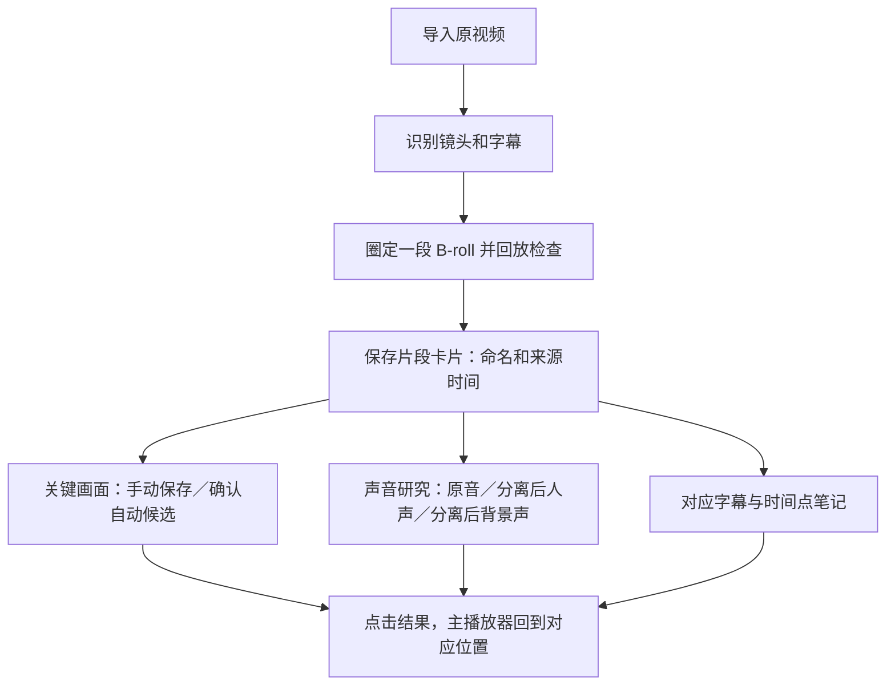

# 【推测】B-roll 片段与文件命名、关键画面与声音回听：产品流程方案

> **⚠️ 历史记录：I/O 已于 2026-09-19 下线、仅作当时留档。**

> 2026-09-18 实现进度：片段记录、多张手动关键画面、片段声音回听、字幕筛选和笔记已经接入；范围及限制见同目录 `2026-09-18-clip-flow-verification.md`。自动选帧、片段 MP4 等导出仍为方案，不属于已实现项。

状态：讨论稿。本文只提出产品设计，没有增加正式功能，没有把组件实验结果当作产品验收结果。

## 产品原点与本轮用户确认

服务自媒体创作者，也供用户自己使用；当前聚焦拉片，帮助快速看懂一段 B-roll 中有什么、哪些画面可用、声音是什么内容。

本轮用户明确：声音功能主要用于单独回听研究，导出使用是后话。由此，声音分离应进入研究回听的小样测试；是否替换波形控件是另一个决定，二者没有必须一起实施的关系。

## 整理单位：一个研究片段可以有多个镜头和关键画面

- 原视频：导入并保存在本机的来源。
- B-roll 研究片段：用户在原视频上圈定的一个连续范围，具有研究目的；可能跨多个自动识别的镜头。
- 镜头：TransNetV2 提供的切换区间，辅助定位。自动切点不直接等同于用户想保留的一段 B-roll。
- 关键画面：片段内由用户确认值得保存的时刻，不要求整个画面完全静止。一个片段可以保存多张。
- 声音、字幕和笔记：均归属于这个片段，并保留回到原视频的时间关系。



建议保留自由圈选，并可吸附到镜头切点；不强制用户只能保存一个镜头。保存片段先记录原视频和入出点，即可限定范围回放；将来需要独立视频文件时再生成裁切副本。片段依赖原视频，移除来源时必须提示受影响的片段，并提供恢复/重新关联路径。

## 命名方式

原则：先能保存，再随时改名。默认名称无需调用 AI。

以下仅为命名示例，不是本轮已保存的真实片段：

| 对象 | 显示方式 |
| --- | --- |
| 片段默认标题 | 黄仁勋 · 片段03 |
| 固定显示的来源信息 | 来源视频名 · 00:18.20—00:26.40 · 8.20 秒 |
| 用户可以改成的标题 | 估值数字动画 |
| 片段内的图片 | 画面01、画面02、画面03；可另写用途备注 |
| 图片时间 | 片段内 00:02.40；详情中显示原片 00:20.60 |

同一视频下按保存顺序生成片段序号；删除或重新排序后不重编号。改标题保留来源和时间关系。

界面标题与实际保存到电脑上的文件名分别规定，具体见下一节。改名不能改变图片、声音与原视频的关联。

## 文件保存名称

【推测】以下是拟采用的保存规则，尚未修改产品实际写文件的逻辑。图片和声音在研究过程中生成的文件，也应采用可读名称；视频、字幕和分镜表的导出仍按对应功能的开发范围实施，不因列出文件名就自动新增导出功能。

默认格式为：`来源短名_片段序号_内容类型或图片序号_原片时间.扩展名`。片段视频可省略“内容类型”。下表沿用片段03、原片 00:18.20—00:26.40 的示例；这些不是已生成的真实文件。

| 保存内容 | 默认文件名示例 | 说明 |
| --- | --- | --- |
| B-roll 片段视频 | `黄仁勋_片段03_00m18s200-00m26s400.mp4` | 起止时间对应原视频；需要独立视频文件时生成 |
| 第一张关键画面 | `黄仁勋_片段03_画面01_00m20s600.png` | 保存原片 20.600 秒的画面 |
| 第二张关键画面 | `黄仁勋_片段03_画面02_00m23s100.png` | 每张图片分别保留自己的原片时间 |
| 片段原音 | `黄仁勋_片段03_原音_00m18s200-00m26s400.wav` | 如需生成独立原音文件，表示包含人声、音乐与音效的原始混合声音 |
| 分离后的人声 | `黄仁勋_片段03_人声_00m18s200-00m26s400.wav` | 用于研究回听的分离结果 |
| 分离后的背景声 | `黄仁勋_片段03_背景声_00m18s200-00m26s400.wav` | 可能包含音乐和音效，不命名为“纯音乐” |
| 片段字幕 | `黄仁勋_片段03_字幕_00m18s200-00m26s400.srt` | 文件名使用原片范围；片段字幕内部时间以片段开头为零，方便与片段视频配套 |
| 片段分镜表 | `黄仁勋_片段03_分镜表_00m18s200-00m26s400.docx` | 需要导出该片段研究结果时使用 |

补充规则：

1. **来源短名**：默认去掉原视频扩展名，允许用户改成短一些的名字；完整原名始终保留在来源信息中。用户提供的原文件不因产品命名而被改名。
2. **时间写法**：文件名使用 `00m18s200`，表示 18 秒 200 毫秒；超过一小时加小时，例如 `01h02m03s400`。毫秒是时间表达精度，不承诺视频具有毫秒级帧精度。界面仍显示熟悉的 `00:18.20`。
3. **自定义标题**：用户给片段起名后，新保存或导出的文件可加入该标题，例如 `黄仁勋_片段03_估值数字动画_画面01_00m20s600.png`。界面改名不自动移动或批量重命名已有文件，避免已有引用失效。
4. **同名与重复保存**：同一片段同一时刻重复收藏时提示“已保存”，定位已有图片。重新生成不同结果时保留旧版，新版加 `_v02`、`_v03`；导出到已有同名文件的位置时加 `_副本02`，不静默覆盖。
5. **编号**：片段与图片编号按首次保存分配，删除、排序或改标题后不重新编号，已存在的编号不被另一条素材占用。
6. **特殊字符**：文件名中的路径分隔符、冒号等不适合文件名的字符统一替换为下划线，扩展名由实际文件格式决定。过长时缩短来源和自定义标题，保留片段号、图片号和时间。
7. **片段范围改变**：新生成的视频、声音、字幕和分镜表使用新的原片范围；旧结果保留原范围并标记需要更新。图片继续记录真实截取时刻；落到新范围之外的图片提示用户处理，不自动删除。
8. **查看与定位**：保存反馈和素材详情同时显示实际文件名及所在文件夹，提供“在访达中显示”；显示名称不能冒充实际磁盘文件名。同名来源视频也应分别保存，不因为名字相同合并素材。

保存命名的验收场景：保存一个片段及其两张不同时间的图片；生成原音、人声、背景声；检查名称能对应到同一片段和各自时间；重复保存不新增相同收藏；重名导出不覆盖；改片段标题和范围后仍能回到正确来源。这里列的是后续验收要求，本轮未执行产品保存测试。

## 多张关键画面放在哪里

建议拉片时就呈现并保存。它们直接帮助比较构图、文字出现顺序和完整布局，不必推迟到后续阶段重新找一遍。

沿用现有拉片页面的主布局：左侧视频库，中间播放器和时间轴，右侧素材收集。

- 右侧素材收集增加“片段”入口，每张片段卡显示标题、入出时间、时长和已存画面数。
- 选中片段后，主时间轴突出其范围；播放可限定在该段，提供清楚的“回到整条视频”。
- 在该片段详情中显示“关键画面／声音／笔记”。图片按时间排序，点图片即定位主播放器，支持逐帧调整后另存或替换。
- 关键画面可以补充“标题出现”“第二组元素到位”“完整布局”等备注，不强制固定角色。
- 整体画面页面可汇总已保存图片，同时显示所属片段；数据只保留一份，避免重复收藏造成混乱。

文字示意（设计稿，不是当前已实现界面）：

```text
视频库             主播放器                           素材收集 · 片段
                   当前片段：估值数字动画               ┌ 片段03
                   [原音] [人声] [背景声]               │ 00:18.20—00:26.40
                   [播放本段] [循环] [回到整条视频]     │ 8.20秒 · 3张关键画面
                                                      ├ 关键画面／声音／笔记
                   ──I════选中的片段════O──             │ [画面01] [画面02]
                   镜头边界、字幕、关键画面时间点         │ [画面03] [+ 保存当前帧]
                                                      └ 点击图片定位主播放器
```

第一版允许直接手动保存关键画面。自动筛选通过真实素材验证后，加入“推荐画面”入口；推荐结果先显示候选，只有用户确认后才进入已保存画面。没有可靠候选时明确显示结果不足，保留手动选帧。

## 声音分离与波形为什么是两回事

声音分离从混合声音中估计人声与背景声，目的是支持分别回听。波形是显示声音随时间变化的图形，主要服务定位和选区；wavesurfer.js 只是可选的显示组件。

之前“先不做”的准确含义应为“尚未验证效果，不直接接入正式产品”，不能理解为否定声音研究价值。用户已确认研究用途，因此下一步可以针对代表性片段做分离试听测试。现有波形无需因此替换。

通过测试后的建议交互：

1. 片段默认播放原音，保持原视频完整可用。
2. 用户点“分离试听”后，只处理当前片段，展示进度与取消入口。
3. 得到结果后，可切换“原音／人声／背景声”。“背景声”可能包含音乐和音效；不能承诺纯净音乐。
4. 切换保持画面和时间位置一致，只播放被选中的一份声音。分离音频与视频使用同一时间基准，需检查起始偏移、长度和漂移。
5. 结果保存在片段下，再次打开可直接回听。片段范围变化后标记结果需更新，避免播放旧范围的声音。
6. 失败时保留原音和已存内容，可重试；检测到没有人声时提示无明显人声，不伪造输出成功。

VAD 主要在后台辅助转写，首版无需把模型选项展示给用户。声音分离是独立能力；两者均需各自验收。

## 测试能力如何进入产品

| 能力 | 小样通过之后的产品用途 | 接入前的验收 |
| --- | --- | --- |
| 普通代码＋FFmpeg | 保存片段范围、准确回放、保存画面和截取声音 | 源时间与片段时间换算正确；同名不覆盖；多张画面刷新后仍能找回 |
| FFmpeg＋OpenCV | 推荐片段中的候选关键画面 | 对已标注的真实片段检查入场未完、黑场、重复帧和漏选；不确定时可手动选择 |
| Silero VAD | 辅助字幕处理 | 字词完整性、字幕时间和长静音情况下的错误，与不启用 VAD 的结果对比 |
| 声音分离组件 | 同一段画面分别回听人声和背景声 | 旁白完整、残留可接受、时间同步、处理失败可恢复；实际试听后再判断 |
| wavesurfer.js | 仅在现有波形存在明确体验问题时考虑替换 | 相同素材与操作下验证同步、拖动和资源消耗确有改善 |

以上均为待实施的产品设计和验收条件，不代表已通过。现有小样证据另见 `2026-09-18-component-pilot.md`。

## 决策表

| 决策 | 内容 | 理由 |
| --- | --- | --- |
| 建议做 | 以 B-roll 片段整理多张关键画面、字幕、声音与笔记 | 保持研究上下文，避免图片和声音散落 |
| 建议做 | 拉片阶段即可手动保存多张关键画面，默认命名并可改名 | 此时已经在挑选画面，推迟会造成重复操作 |
| 建议做 | 统一片段视频、图片、声音、字幕与分镜表的实际文件名，并在详情中显示 | 离开产品后仍能辨认来源、所属片段和时间 |
| 建议做 | 声音分离进入小样试听测试，测试通过后提供按片段分离回听 | 用户已确认以声音研究为主要用途 |
| 需要你决定 | 是否采用本文“右侧片段卡片＋片段详情”的呈现方案 | 这是本轮待审阅的产品设计，尚未改动正式页面 |
| 建议不做 | 因为增加声音分离就同时替换波形控件，或自动处理所有导入素材 | 两者没有绑定关系，默认批处理还会增加等待与资源占用 |
