# 拉片工作台：从“看完一条视频”到“得到可复用的视听证据”

> **⚠️ 历史记录：I/O 已于 2026-09-19 下线、仅作当时留档。**

> 文档用途：用于课程讲解、产品演示和后续教学文档提炼。  
> 对应版本：2026-09-18 当前本地实现。  
> 本文只讲已经落地的“拉片工作台”，不把更大的 B-roll 再创作 PRD 或未完成设想当作现有功能。

---

## 1. 先用一句话讲清楚

**拉片工作台是一个本地的“视频研究台”：它帮用户在原视频的统一时间轴上，拆画面、转文字、分人声与背景声、标记音乐变化，再把值得研究的范围、关键画面和观察结论保存下来，并且始终能回到原片复查。**

它要解决的不是“如何看一条视频”，而是：

- 哪里发生了镜头切换？
- 这句话和哪一帧画面对应？
- 画面、人声、配乐在同一时刻如何配合？
- 这一段值得研究的起止范围在哪里？
- 我看到的组图、字幕、动效和声音规律，如何记录、查找和复用？

### 它不是什么

- 不是 Premiere、Final Cut 或剪映的替代品。
- 不是一键自动成片工具。
- 不会改写、切碎或覆盖用户的原文件。
- 不依赖大语言模型，也不需要填写 LLM API Key。
- 当前保存的“研究分镜”是原片时间范围与研究资料，不会自动生成新 MP4。

---

## 2. 这个工作流在表达什么

它表达的不是一条“机器自动处理管线”，而是一个**人机协同的视听研究循环**：

1. 机器帮人快速建立可导航的结构：镜头、字幕、波形、人声、背景声和音乐建议段。
2. 人在时间轴上判断“哪一段值得研究”。
3. 人通过逐帧、回听、单独听轨、保存关键画面和写观察，把直觉变成证据。
4. 所有证据都带有原片时间，可以随时回到上下文复查。
5. 结果可以用于课程案例、拉片笔记、分镜表、模板拆解和后续 B-roll 复刻。

### 核心转换


用于教学时，可以把它总结为：

> 拉片不是“多看几遍”，而是把一条视频变成“可定位、可拆解、可记录、可回看、可导出”的研究对象。

---

## 3. 先分清 6 个对象

这个工作台最容易讲混的地方，是把“原片、镜头、范围、分镜和素材”都叫成片段。教学时建议明确区分：

| 对象 | 是什么 | 会不会生成新媒体 | 主要用途 |
| --- | --- | --- | --- |
| 原视频 | 导入的完整来源 | 不修改原文件；必要时生成可播放副本 | 所有研究的时间基准 |
| 原片镜头 | 画面切换识别出的相邻时间段 | 生成缩略图，不切成多个视频 | 快速跳镜头、看节奏、组成画面轨 |
| I/O 播放范围 | 临时的入点和出点 | 不保存文件，不自动建立分镜 | 循环回看、对比和精调范围 |
| 研究分镜 | 用户明确保存的原片时间范围，可以跨越多个镜头 | 不自动导出 MP4 | 容纳该范围的画面、声音、字幕和笔记 |
| 关键画面／声音 | 从原片保存出来的 PNG、M4A 或 WAV | 会生成实际文件 | 教学引用、对比、素材整理 |
| 时间点观察 | 绑定原片时间的笔记 | 只保存结构化记录 | 记构图、转场、文字动效和声音衔接 |

### 对象关系图

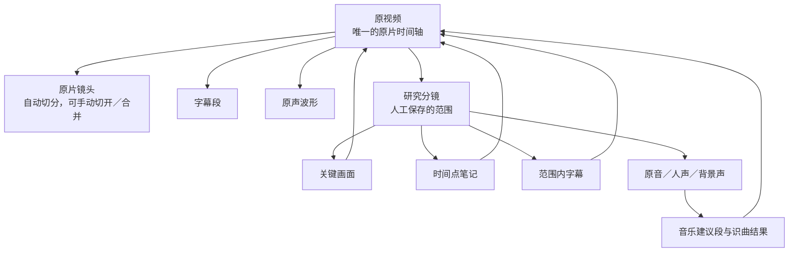

**讲课时需特别强调：**I/O 是“播放控制”，剪刀或保存动作才是“写入研究记录”。这个区分可以避免学员试听时误产生大量分镜。

---

## 4. 端到端工作流

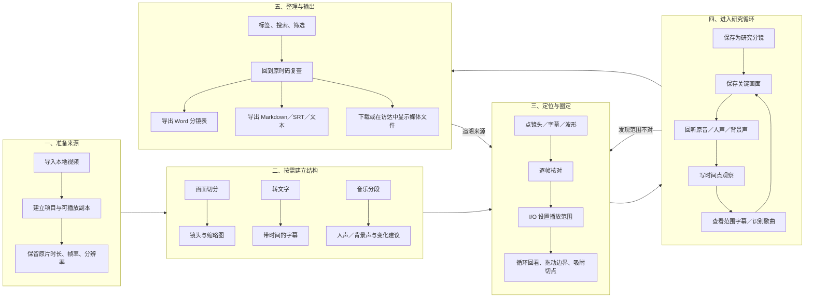

### 流程的核心特征

- **按需分析**：导入和浏览不自动开启所有重任务；由用户点“画面切分”“转文字”“音乐分段”。
- **非线性研究**：保存分镜后，画面、声音、字幕和笔记可以自由交替，不是必须按顺序完成的向导。
- **原片时间不变**：所有轨道、笔记、关键帧和分镜都使用同一条原片时轴。
- **分析是建议，人负责判断**：自动切镜、语音识别、音乐变化和识曲都可能出错，必须回看原片。

---

## 5. 界面如何承载这条流程

工作台把“选来源、看上下文、精准定位、保存证据”同时放在一个桌面布局中。

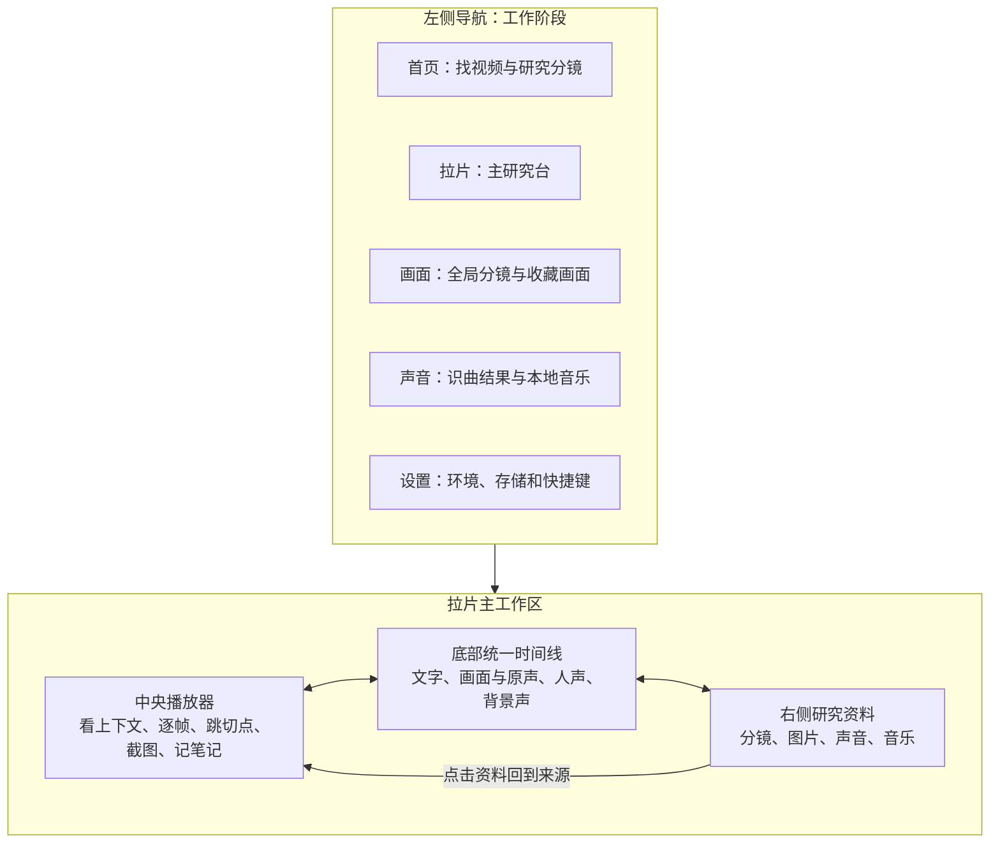

### 5.1 五个一级页面

| 页面 | 用户问题 | 主要能力 |
| --- | --- | --- |
| 首页 | 我要研究哪条视频，以前保存了哪些分镜？ | 导入、搜索、来源筛选、标签交集筛选、排序、视频封面与研究分镜入口 |
| 拉片 | 这条视频的画面、语言和声音如何对齐？ | 播放器、分析入口、时间线、I/O、分镜编辑、三轨回听、研究资料 |
| 画面 | 我想跨视频查看分镜和已保存画面 | 分镜网格、收藏画面、标签筛选、大图、六色色板、来源回跳 |
| 声音 | 我想查看识别到的配乐或管理本地音乐 | 歌曲列表、封面、试听、标签、来源回跳、本地音乐导入 |
| 设置 | 本地处理环境是否就绪，快捷键是什么？ | 运行环境、数据位置、快捷键 |

### 5.2 拉片页的四个区域

| 区域 | 看什么 | 做什么 | 为什么放在这里 |
| --- | --- | --- | --- |
| 可收起的视频库 | 视频封面、时长、来源和标签 | 换参考片、搜索和筛选 | 让“换来源”不打断研究环境 |
| 中央播放器 | 完整上下文与当前帧 | 播放、逐帧、跳镜头、截图、写笔记、换预览清晰度 | 原片始终是判断基准 |
| 右侧研究资料 | 与当前视频相关的分镜、图片、声音、音乐 | 打开详情、保存画面、查字幕、写观察、下载和回跳 | 让“边看边记”不离开主播放环境 |
| 底部时间线 | 文字、画面、原声、人声、背景声的时间关系 | 启动分析、定位、圈范围、调音量、单独听轨、切开／合并镜头 | 视听关系需要在同一时间尺上比较 |

---

## 6. 界面与工具是怎样“镶嵌”的

这个工作台的表面是网页界面，后面是一组按任务被调用的本地处理器。不应把工具名字全部堆在界面上，而是让用户看到自己要完成的任务。

### 6.1 “任务按钮”对“处理引擎”

| 界面上的话 | 背后的工具 | 输入 | 产出 | 界面回填位置 |
| --- | --- | --- | --- | --- |
| 导入视频 | Python 本地服务 + FFprobe + FFmpeg | 本地视频字节 | 项目记录、媒体参数、可播放副本 | 首页视频卡、播放器 |
| 画面切分 | TransNetV2 + PyTorch + FFmpeg | 原片连续帧 | 镜头切点、镜头范围、真实缩略图 | 画面轨、右侧分镜、画面页 |
| 转文字 | FFmpeg + whisper.cpp + large-v3-turbo q5_0 | 提取后的 16 kHz 单声道语音 | 带起止时间的字幕段 | 文字轨、分镜字幕、SRT／TXT／MD 导出 |
| 音乐分段 | audio-separator + UVR-MDX-NET-Inst_HQ_3 + 本地声学变化分析 | 原片音轨 | 人声、背景声、建议切点 | 人声轨、背景声轨、音乐块 |
| 识别本段歌曲 | shazamio + Shazam + iTunes Search | 所选范围内的音频指纹 | 歌名、歌手、封面、外部资料链接 | 右侧音乐资料、声音页 |
| 保存当前画面 | FFmpeg | 当前原片时码 | 原尺寸 PNG／JPG | 右侧图片、画面页、分镜画面 |
| 保存声音选区 | FFmpeg | I/O 范围 | M4A 声音文件 | 右侧声音 |
| 分离分镜声音 | audio-separator | 研究分镜的原声 | 原音、人声、背景声 WAV | 三轨波形和分镜声音资料 |
| HQ／SQ／LQ | FFmpeg 本地预览缓存 | 原片 | 不同分辨率的预览视频 | 只替换播放器清晰度 |
| 导出分镜表／字幕 | Python 导出逻辑 | 项目 JSON、缩略图、字幕、笔记 | DOCX、MD、SRT、TXT、CSV、JSON | 下载并记录到导出文件区 |

### 6.2 完整技术关系

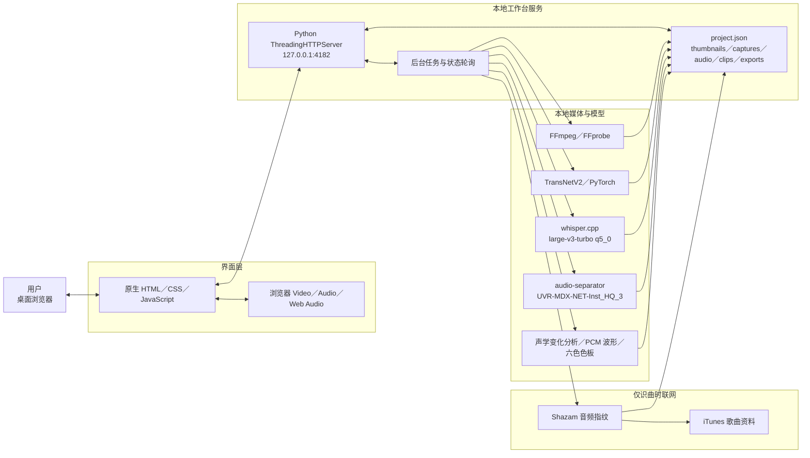

### 6.3 界面和工具的设计原则

1. **界面讲用户任务，状态讲处理进度，设置页再讲工具名称。**  
   例如按钮写“转文字”，处理中写“转写中 62%”，只在设置或说明中补充“whisper.cpp large-v3-turbo”。
2. **工具结果要回到原时间线。**  
   字幕不是一份孤立文字，分轨也不是一组孤立音频；它们必须在相同时码上和画面对齐。
3. **长任务必须可见。**  
   按钮要显示未处理、处理中、已完成、失败和重试状态；完成前不编造结果。
4. **预览与研究数据分离。**  
   切换 HQ／SQ／LQ 只影响播放流畅度，截图、识别、导出仍基于原片。
5. **机器判断保留“建议”身份。**  
   音乐分段只是“声音变化建议”，不声称精确找到换曲点；背景声也不冒充“纯音乐”。

---

## 7. 主要功能是怎样流转的

### 7.1 导入与项目创建

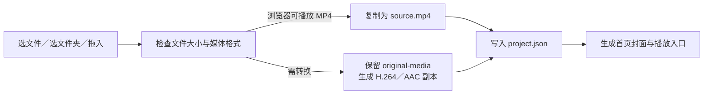

- 单个上传上限为 20 GB。
- 原电脑里的文件不会被修改。
- 无法解码时显示失败，并清理未完成的上传目录。

### 7.2 画面切分

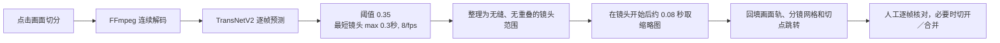

模型的任务是节省“找切点”的时间，不是代替编辑对切点的判断。

### 7.3 字幕识别

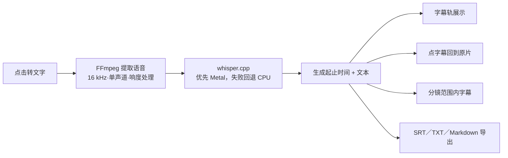

字幕保留的不只是文字，而是“文字与时间的对应关系”。

### 7.4 范围选择与研究分镜

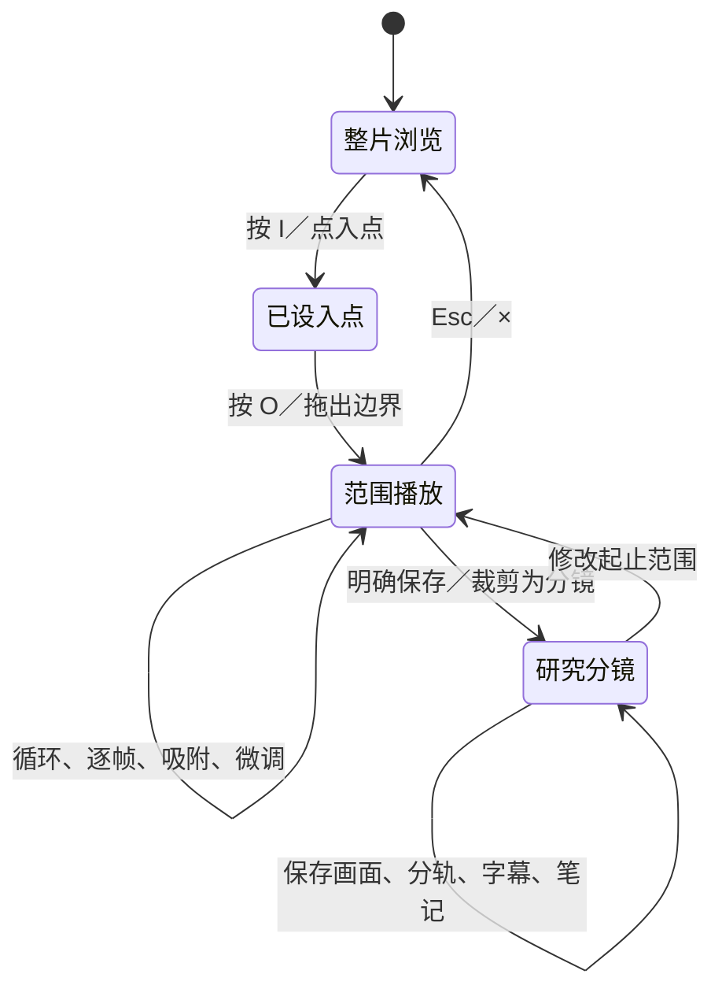

- 时间线靠近镜头、笔记或字幕边界时可自动吸附；按 Alt 临时取消。
- 方向键始终一帧一步。
- 到 O 点后默认停止；用户可显式开启范围循环。
- 修改已有分镜范围时，旧声音结果保留在历史中，范围外画面和笔记会被标出。

### 7.5 声音分离、试听和音量

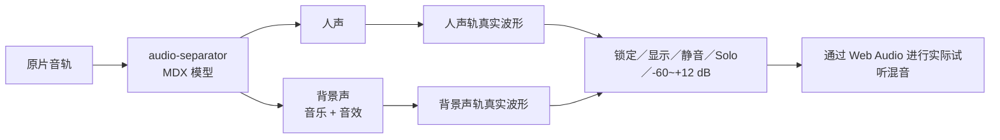

声音试听有一条重要规则：**原片原声与分离后的人声／背景声互斥**，不同时播放，避免同一声音叠加两次。

音量线使用的是真实增益，不是只改显示：

- 中线为 0 dB；
- 上拖放大，下拖减小；
- 范围为 -60 dB 到 +12 dB；
- 双击恢复 0 dB；
- 只影响工作台试听，不改写原视频。

### 7.6 音乐分段与识曲

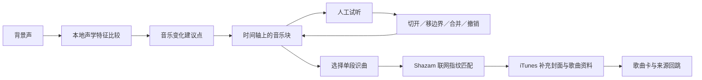

这里需要避免两个过度承诺：

- 自动建议点只代表“声学特征明显变化”，不一定是换了一首歌。
- 背景声包含音乐和音效，当前不能单独命名音效事件。

---

## 8. 一次完整的实操示范

下面是课堂上最适合演示的顺序。例子时长约 10–15 分钟。

1. **导入一条参考片**  
   从首页导入，说明原文件不改动，工作台建立的是本地研究项目。
2. **进入“拉片”，先不做所有分析**  
   展示用户可以先浏览，说明处理是按需启动的。
3. **点“画面切分”**  
   展示处理状态，然后点击几个自动镜头，用上下方向键跳切点，用左右方向键逐帧核对。
4. **点“转文字”**  
   展示字幕块与原片时间对齐，点一句话回到对应画面。
5. **圈一个跨镜头范围**  
   按 I 设起点，按 O 设终点，拖动边界、打开循环，说明此时还只是试听范围。
6. **明确保存为研究分镜**  
   在右侧打开分镜详情，讲清它可以跨越多个自动镜头。
7. **保存 2–3 张关键画面**  
   每张画面停在一个有分析价值的时刻，例如入场前、主画面成立时和退场前。
8. **写一条时间点观察**  
   例如：“主标题在画面成立后 6 帧入场；配乐在转场前先减弱。”然后点时间回看。
9. **启动音乐分段或单分镜声音分离**  
   切换人声 Solo 和背景声 Solo，演示声音分析不脱离原片时间。
10. **识别一个音乐段并回到来源**  
    提醒学员：这一步会联网，而且可能没有匹配结果。
11. **导出 Word 分镜表和 SRT**  
    结束时展示：产物不只是一个视频，而是可检索、可追溯的研究资料。

---

## 9. 数据是怎么保存的

### 9.1 本地优先

工作台运行在 `127.0.0.1:4182`，网页、项目数据和大部分模型处理都在本机完成。正常的切镜、字幕、分轨、波形、截图、标签、笔记和导出不依赖云端模型。

### 9.2 项目目录

```text
data/<项目ID>/
├── project.json             # 项目状态、时间范围、标签、笔记、任务结果
├── source.mp4              # 工作台使用的可播放媒体
├── original-media.*        # 需转换格式时保留的原媒体
├── waveform.json           # 原声 PCM 峰值波形缓存
├── thumbnails/             # 自动镜头缩略图
├── captures/               # 全局保存画面
├── audio/                  # 全局保存声音
├── clips/<研究分镜ID>/  # 分镜画面、原音、人声、背景声和波形
├── previews/               # SQ／LQ 本地预览缓存
└── exports/                # DOCX、SRT、TXT、MD、CSV、JSON
```

`project.json` 是项目事实源；界面、分镜表和导出文件都是对这些结构化数据的展示或派生结果。

### 9.3 什么时候联网

| 操作 | 平时是否联网 | 说明 |
| --- | --- | --- |
| 播放、切镜、转字幕、分轨、波形、截图、笔记、导出 | 否 | 已安装好依赖和模型后可本地完成 |
| 识别歌曲 | 是 | 本地生成音频指纹，向 Shazam 查询，再用 iTunes 补充资料 |
| 首次安装依赖或模型 | 是 | 当前这台机器已准备好 |

---

## 10. 当前已经做到的能力

### 素材与项目

- 本地多文件、文件夹和拖拽导入。
- 视频库搜索、来源筛选、多内容标签交集筛选和排序。
- 不可直接播放的媒体转换为本地 H.264／AAC 副本。
- 位置、选区、缩放、展开状态和音轨设置按视频恢复。

### 画面研究

- 本地自动镜头检测、真实缩略图、切点跳转和逐帧核对。
- 可以在画面轨切开镜头、合并相邻镜头和撤销调整。
- I/O 范围、范围循环、边界拖动、吸附、缩放和时间刻度。
- 保存关键画面、查看六色色板、标签和来源回跳。

### 文字与观察

- 本地语音转字幕、时间对齐、点句定位。
- 范围内字幕查看。
- 全局时间点笔记和分镜内时间点观察。
- 笔记草稿保存、冲突保护和移除后即时撤销。

### 声音研究

- 真实 PCM 峰值波形。
- 原音、人声、背景声三轨对齐。
- 轨道锁定、显示、静音、Solo 和 -60 至 +12 dB 试听增益。
- 背景声变化建议段、手动切分、边界调整、合并与撤销。
- 对单个音乐段联网识曲，保留识别状态和失败重试。

### 输出与恢复

- 带真实缩略图、字幕、标签和笔记的 Word 分镜表。
- 字幕与结构数据导出。
- 图片和声音文件下载、在 macOS 访达中显示。
- 后台失败保留已有项目，页面显示失败与重试。

---

## 11. 当前边界和课堂上要说清的事

| 边界 | 教学中的准确说法 |
| --- | --- |
| 自动镜头不一定全对 | 它是“预切分”，最终用逐帧和切开／合并核对 |
| Whisper 会有错字 | 字幕是导航和研究辅助，引用前要回听 |
| 音乐切点是建议 | 只说明声学特征发生变化，不声称必然换曲 |
| 背景声不等于纯音乐 | 它包含音乐和音效，当前不做音效事件级命名 |
| 识曲需联网 | 可能识别不到，网络错误和无匹配是两种状态 |
| 研究分镜不是 MP4 | 它是“原片范围 + 研究证据”，而不是新视频文件 |
| 不是专业非编 | 不支持任意多轨拼接、特效、调色和终片剪辑 |
| 轨道是对齐研究，不是自由剪辑 | 三条声音轨与原片共用时间，不支持单轨自由移动或拼接 |
| “移除”不是完整回收站 | 当前是软删除和即时撤销，没有跨重启的长期回收站 |
| 长任务管理还有空间 | 上传、切镜和转字幕还缺统一的取消与断点续传 |
| 当前是本地网页 | 尚不是独立 Mac 安装包，浏览器与其他 Mac 应用之间的原生拖拽尚未全面验收 |

---

## 12. 与更大的 B-roll 工作流是什么关系

当前拉片工作台处在更大流程的**参考片研究和证据生产阶段**，它还不是“为新口播自动生成 B-roll”的日常制作台。

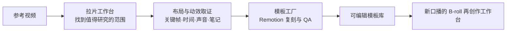

这个定位很重要：

- 拉片工作台回答“参考片怎么做的”。
- 模板工厂回答“如何把这套视觉语法复刻成可替换模板”。
- 日常 B-roll 工作台回答“新口播哪里需要什么画面，如何换成我的内容”。

三者可以共用来源记录、模板库、渲染和 QA，但不应在教学中混为一个“万能工具”。

---

## 13. 建议的课程结构

### 45 分钟版

| 时间 | 内容 | 学员应该带走什么 |
| --- | --- | --- |
| 0–5 分钟 | 什么是拉片，为什么“看懂了”不等于“拆清了” | 拉片的产物是可追溯证据 |
| 5–10 分钟 | 六个数据对象 | 原片、镜头、I/O、研究分镜、关键画面、观察笔记的区别 |
| 10–20 分钟 | 导入、画面切分、转文字、定位 | 如何快速建立可导航结构 |
| 20–30 分钟 | I/O、循环、保存研究分镜、关键画面和笔记 | 如何把“感觉”变成带时码的证据 |
| 30–38 分钟 | 人声／背景声、Solo、增益、音乐分段与识曲 | 如何研究画面与声音的关系 |
| 38–43 分钟 | 标签、回跳和导出 | 如何形成可检索、可教学的素材包 |
| 43–45 分钟 | 边界与下一步 | 工作台是研究台，不是自动成片器 |

### 学员作业

选一段 20–40 秒的参考片，提交：

1. 一个准确的研究分镜范围。
2. 三张关键画面：成立前、主状态、退场前。
3. 一条关于构图或文字动效的时间点观察。
4. 一条关于人声、配乐或转场声音的观察。
5. 一份导出分镜表或字幕文件。
6. 一句结论：“这一段为什么值得复刻？”

---

## 14. 可直接用在课程里的讲解稿

> 拉片工作台不帮我们替代判断，它帮我们把判断做得更精确。我们先把原视频变成可导航的镜头、字幕和声音轨，再用原片时间轴找到值得研究的连续范围。范围确定后，我们保存关键画面，分开回听人声和背景声，把构图、文字、转场和声音的规律写成带时码的观察。最后得到的不是一堆散乱截图，而是一套随时可以回到原片验证的研究证据。

---

## 15. 最适合放在课件首页的图

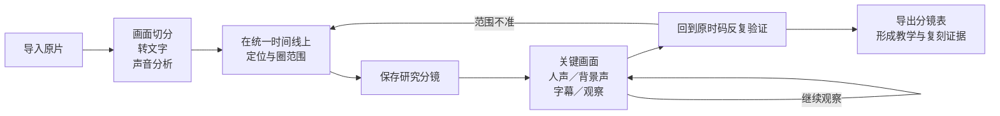

**课件标题建议：**

> 拉片工作台：把“看懂”变成“有证据地拆懂”
